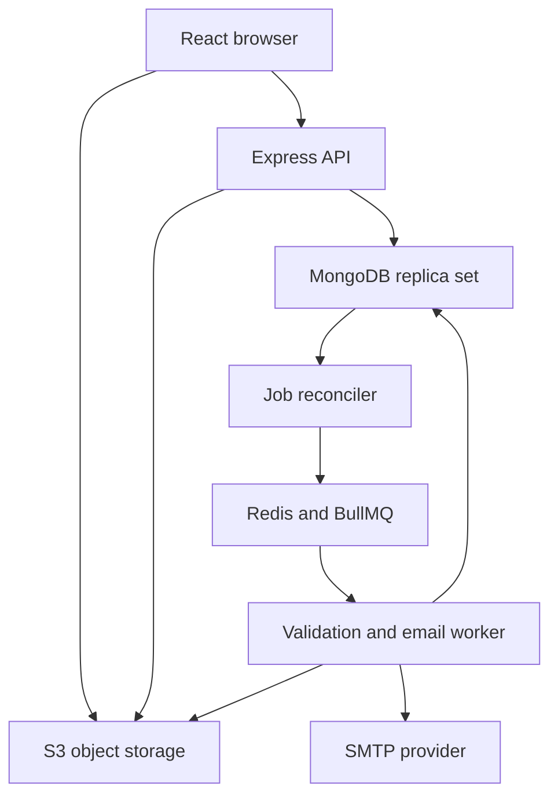

# Architecture and consistency

The browser requests event and workspace JSON from Express. It uploads file parts directly to S3-compatible storage. Express writes durable MongoDB submission receipts and validation jobs within one transaction. A worker reconciles durable jobs into BullMQ and processes them separately from the HTTP server.

## Receipt and version rules

Each finalisation carries a UUID idempotency key. A unique index on teamId and key prevents duplicate operations. The server stores a fingerprint of upload and project content and rejects reuse with a different request. The transaction increments the team version, writes the submission, writes the durable job and records its audit event. It also creates member receipt notifications. Retrying the same operation returns its original receipt.

Uploads snapshot project fields and deadline policy when initiated. Saving project edits later affects the next upload. This makes grace-period content stable and auditable. A team member can submit a different archive as a new version. Matching file hashes produce a warning. Receipt records survive validation failure.

## Deadline policy

All persisted timestamps are UTC. The UI displays IST explicitly.

A receipt at or before the configured deadline is eligible. During the configured grace period, only upload sessions initiated at or before the deadline are eligible. The cutoff is inclusive to the millisecond. The initial grace is five minutes. A storage object completed before the deadline but finalised after the grace cutoff receives a late receipt. Starting an upload alone never reserves a receipt.

Editing project fields and starting uploads close at the main deadline. Existing uploads can complete and finalise during their policy window. The receipt time is captured by the API before the transaction begins. Database execution time can therefore follow the receipt timestamp. This application uses trusted API receipt time, and requires synchronised server clocks in deployment.

The latest eligible version is identified independently of validation status. A newer invalid eligible version remains visible as the latest eligible version, with its failure status. Historical versions remain available.

## Data and indexes

Users contain local identity, a salted password hash and a role. Sessions hold a hashed opaque token and a TTL expiry. Events hold the organiser, public fields, windows, limits, required fields and policy. Registrations uniquely identify an event and user. Teams contain event-scoped membership, leader, invite expiry and project draft.

Uploads identify storage keys, multipart IDs, file metadata and the captured policy. Submissions have unique team/key and team/version indexes. Durable jobs use a unique dedupe key. Notifications use user/dedupe uniqueness. Validation audit records have a unique sparse dedupe key. Bookmarks use user/event uniqueness.

Transactions require a MongoDB replica set. Team joins update both membership and registration inside a transaction. Concurrent joins conflict on the team document and retry. Team departures transfer leadership to the first remaining member. Empty teams are archived so earlier receipts retain their references.

## Jobs and recovery

BullMQ delivers work at least once. Validation is safe to retry. Terminal submission statuses are protected from being overwritten by intermediate states, and notifications and audit entries use dedupe keys. A retry repairs side effects even when a previous worker died after writing the final status.

The reconciler scans pending durable jobs and recreates missing queue entries. Failed jobs are visible in the organiser screen. An organiser can reset a failed job to pending. BullMQ handles lost worker locks and stalled attempts.

SMTP has no universal exactly-once delivery guarantee. A worker writes a sending state before sending. An interrupted or ambiguous send becomes uncertain and requires inbox/provider inspection before an organiser retries. Explicit connection failures and SMTP rejection responses can retry. SMTP acceptance is recorded separately from delivery.

## File processing

The browser hashes the selected file and uploads 8 MiB parts. The API lists stored parts for resume, signs missing parts and checks object size at completion. Validation reads up to 100 MiB into memory, verifies SHA-256, inspects ZIP content, rejects unsafe paths, encrypted entries, symlinks and nested archives, and limits entries, expansion size and compression ratio. README content is displayed as plain text.

Limits are 5,000 entries, 500 MiB expanded bytes and a 100:1 per-entry expansion ratio. Three validation jobs can execute concurrently. Account for the memory budget when deploying and benchmarking.

Link checking accepts HTTPS on port 443, rejects credentials and private/reserved IPs, pins the validated DNS result for the request and revalidates redirects. Network failures retry. Explicit invalid responses become participant-facing validation failures.

## Reference sources

- Supplied Hack4Hack Extension Guide and reference ZIP.
- BullMQ retry and idempotency guidance — https://docs.bullmq.io/patterns/idempotent-jobs
- BullMQ stalled workers — https://docs.bullmq.io/guide/workers/stalled-jobs
